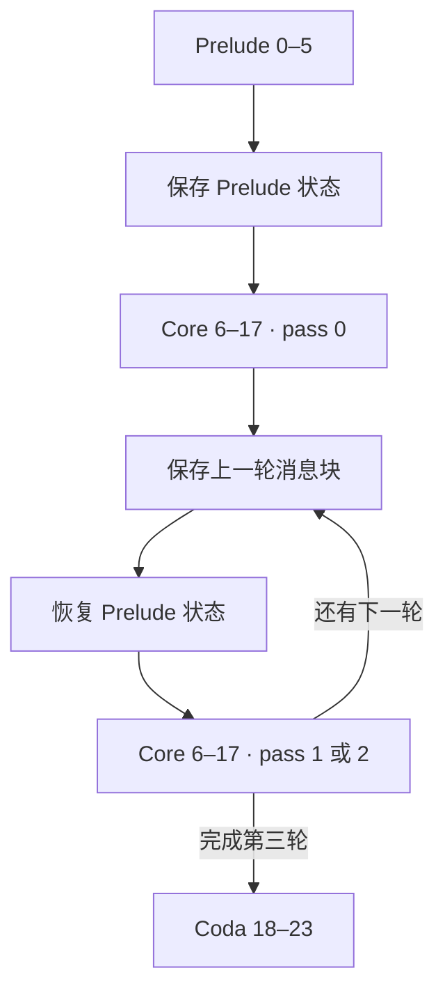

# Inkling 2 Mini：架构与移植边界

核验日期：2026-11-24。本文描述公开模型及上游实现，Ascend 部分为本仓的工程设计，尚无本仓 NPU 实测结果。

## 1. 结论

Inkling 2 Mini 可以按「复用 vLLM 调度与模型配置，新增 Ascend 模型实现、注意力后端和算子」的路线适配。循环本身是固定顺序的层访问；主要工程量来自相对位置注意力、短卷积缓存、跨轮消息、特殊 MoE 数值路径，以及 NVIDIA 量化格式的加载与计算。不能仅通过注册模型或设置 `--dtype bfloat16` 完成移植。

上游 [Mini PR #69028](https://github.com/vllm-project/vllm/pull/69028) 已合并；本文代码基准为其合并提交 [`ab18334a4f60da74db7de89fe95594e5ed0cda36`](https://github.com/vllm-project/vllm/commit/ab18334a4f60da74db7de89fe95594e5ed0cda36)。该实现明确列出 NVIDIA 硬件验证；这些结果不构成本仓的 Ascend 支持声明。

## 2. 模型身份及配置

下表来自发布方模型卡和 Hugging Face 初始上传提交的 `config.json`，而不是通用配置类的默认值。生产部署还须固定实际下载的模型 revision 并再次核验。

| 项目 | Inkling 2 Mini 发布配置 | 工程意义 |
|---|---|---|
| 架构名 | `Inkling2LoopForConditionalGeneration` | Ascend 模型注册必须匹配 |
| 顶层 model type | `inkling2_loop` | 不用旧 `Inkling` 或非循环 `inkling2` 替代 |
| 物理 decoder 层 | 24 | 权重只保留 24 层 |
| hidden size | 2304 | 控制器、残差、投影输入宽度 |
| Q / KV heads | 24 / 8 | 首期 TP 候选为 1、2、4、8 |
| head dimension | 128 | 不能按 `2304 / 24` 推断成 96 |
| MoE | 128 个 routed experts，top-8，无 shared experts | 保留路由偏置及路由权重语义 |
| expert intermediate | 1152 | `w13` 是 gate/up 合并矩阵 |
| local / global 层 | 20 / 4；global 为 5、11、17、23 | 层编号从 0 开始 |
| local window / short conv | 1024 / 4 | 窗口边界与跨 chunk 状态必须分别测试 |
| 相对位置参数 | `d_rel=16`、`rel_extent=1024` | 不是直接替换成 RoPE 的模型 |
| 循环核心 | `[6,18)`，固定 3 轮，controller rank 64 | 每轮共享权重，缓存独立 |
| AttnRes block | 每 6 层一个 block；归一化 values | 不是普通逐层 residual add |
| log scaling floor | 8192 | 不沿用通用配置默认的 128000 |
| vision | 23 层，hidden 1024，16 heads | 第二阶段单独接入 |
| 最大模型上下文 | 1,048,576 tokens | 配置能力上限，不是本项目首期部署目标 |

发布方给出总参数 26.4B、物理激活参数 3.4B；计入核心层重复计算后，有效激活参数约 5.4B/token。把 3.4B 直接作为推理计算量估算会低估重复访问。[模型卡](https://thinkingmachines.ai/model-card/inkling-2-mini/)；[发布配置所在提交](https://huggingface.co/thinkingmachines/Inkling-2-Mini/commit/1fb4134b9a74f9681054f4ef82e4bf1f458a2337)。

## 3. 正确的循环执行

访问顺序为：

1. Prelude：物理层 0–5，执行一次。
2. Core：物理层 6–17，依次执行 pass 0、pass 1、pass 2。
3. Coda：物理层 18–23，执行一次。

因此每 token 的层访问数是 `6 + 12 × 3 + 6 = 48`。区分三个索引：`physical_layer_id` 用于权重，`pass_id` 用于缓存与消息，`visit_id` 用于执行轨迹和后续 DSpark 隐状态采样。不能复制核心权重三份，也不能把 pass 1/2 当作新 token。

每个后续 core pass 从保存的 Prelude AttnRes 状态开始，再读取上一轮 core 的两个 block 形成消息。上游会克隆消息 bank 后恢复 Prelude partial；直接沿用上一轮最终 hidden state 连跑三次，会改变模型计算。Coda 接最后一轮状态。

固定发布 checkpoint 的 `is_varloop=false`；上游校验会拒绝任意覆盖轮数或共享 KV。可调轮数的 `TML-d24-varloop-research` 是另一个 checkpoint，不能把其选项当作 Mini 的节省显存开关。[循环实现](https://github.com/vllm-project/vllm/blob/ab18334a4f60da74db7de89fe95594e5ed0cda36/vllm/models/inkling2/nvidia/loop.py)；[配置约束](https://github.com/vllm-project/vllm/blob/ab18334a4f60da74db7de89fe95594e5ed0cda36/vllm/models/inkling2/configs.py)。

## 4. 跨轮消息与数值边界

每个核心层有 `attn / k / v / mlp` 四条消息流。伪查询是学习参数 `[Q,D]`，没有 token 维；读 bank 的输出是 `[Q,T,D]`。查询在权重后处理阶段乘 `D**-0.5`，只做一次。

controller 的基本流程是：分别对 destination 和 message 做 RMS 归一化，拼成 `[S,T,2D]` BF16 输入；与 `[S,r,2D]` 权重做批量下投影，再用 `[S,2D,r]` 权重得到 gain/forget FP32 张量。融合公式为：

$$
y=(1-\tanh(f))\odot destination+\tanh(g)\odot message.
$$

融合结果保持 FP32，再执行该子层的 RMSNorm 得到 BF16 输入。参数 dtype、投影输出 dtype、融合 dtype 是不同的约束，不能统一调用 `.bfloat16()` 替代。上游融合 kernel 还显式控制浮点融合运算，应将参考结果作为 Ascend 算子对齐依据。[控制器及批量权重布局](https://github.com/vllm-project/vllm/blob/ab18334a4f60da74db7de89fe95594e5ed0cda36/vllm/models/inkling2/nvidia/loop.py)。

AttnRes 对已完成 block 和当前 partial block 求混合：分数由伪查询与归一化 block 点积产生，softmax 沿 block 维执行。发布配置使用归一化 values；输出是否做最后 RMSNorm 取决于后续是否还要进入 controller。具体接口见 [算子设计](operator-design.md)。

## 5. Attention 不是普通 GQA 的直接替换

上游实现同时包含以下语义：

| 路径 | 必须保留的行为 | 昇腾首期方案 |
|---|---|---|
| 投影 | q、r、gate、sink、k、v；后续 pass 的 local 层也可有独立 xq/xk/xv | 分离投影建立正确基线，再评估合并 GEMM |
| q/k/r | L2 clipping；q/r 含学习 scale | 明确 FP32 累加及裁剪顺序 |
| K/V 预处理 | 短卷积；V 无 gamma 的归一化 | 独立参考算子，随后融合 |
| local | 静态 K/V 卷积、滑窗相对位置注意力 | 确认窗口包含端点、paged cache 写读 |
| global | 输入相关的动态 K/V 卷积及 log scaling | 不能复用静态 conv 结果 |
| logits | `head_dim**-0.5` 缩放及相对位置项 | 不套用旧 Inkling 的缩放规则 |
| 输出 | gate、sink 修正；注意力路径需要正确 LSE | 核验 CANN 接口能力后决定融合或自定义 |
| TP | `wo` 给出本 rank partial；外层归约 | 记录 output 是否已归约，防止重复 sum |

模型层语义可以复用；NVIDIA FA4、CuTe、CUDA 通信融合、GPU 专用 Triton 启动方式需要替换。标准 attention 算子是否可直接承载相对位置项与 sink，必须按固定 CANN 版本的接口和精度测试决定；仅看到「支持 GQA/SWA」不足以证明等价。[注意力源码](https://github.com/vllm-project/vllm/blob/ab18334a4f60da74db7de89fe95594e5ed0cda36/vllm/models/inkling2/nvidia/attention.py)。

## 6. 缓存与显存

固定 3 轮配置共需 48 个逻辑 attention cache owner 与 48 个逻辑 conv-state owner。前者包含 40 次 local attention 和 8 次 global attention；每个 conv owner 包含 K、V、attention output、MLP output 四条流。owner 数不等于独立大块物理分配数，底层可按 cache group 共享 backing storage，但不同 `(layer,pass)` 的地址和内容不能混淆。

message bank 是本次 forward 中的中间状态，不是再额外维护一套覆盖整个历史序列的 KV。反过来，short-conv window=4 也不意味着可以忽略 vLLM 的分页、对齐和元数据占用。

只计算 BF16 attention KV 的逻辑量，TP=1 时：

$$
M_{KV}=2\times8\times128\times2\times
\left(8L+40\min(L,1024)\right)\ \text{bytes/sequence}.
$$

这里乘数依次代表 K/V、KV heads、head dimension、BF16 bytes；`L` 是单条序列长度。32,768 tokens 的逻辑值约 1 GiB global KV + 160 MiB local KV。该值未包含 block 对齐、保留块、conv state、临时激活、消息、通信或运行时。TP 分片后能分摊的部分还要按后端实际布局确认。[缓存与循环设计](cache-and-loop.md)。

26.4B 参数全部按两字节粗估约 52.8 GB（49.2 GiB）；这是静态权重量级，不是 A2 64 GB 单卡完整服务可运行的证明。首期建议算子及 tiny 模型在 TP1 排错，完整 BF16 expert 方案先用 TP2/TP4 建立基线，再评估 TP8 与多副本。

## 7. 第二阶段图像

纯文本服务先禁止图像输入，并使视觉权重不实例化；保留原有文本 tokenizer、chat template 和发布配置。不要通过任意删改配置字段伪装成另一架构。

图像阶段按「processor 与 patch/grid 对齐 → vision encoder → projector → multimodal embedding 合并 → 带图 prefill」逐层验证。视觉 token 进入 decoder 后同样经历 48 次层访问。动态图像尺寸、图像数量、位置编码插值、视觉 token 数量和图像前后文本布局都应纳入测试。DSpark、LoRA、量化优化和图像是独立能力，只有各自通过测试才加入支持矩阵。

## 8. 与旧项目的关系

[Ascend RFC #20812](https://github.com/vllm-project/vllm-ascend/issues/20812) 和 [Draft #20831](https://github.com/vllm-project/vllm-ascend/pull/20831) 针对较早的 Inkling/MTP。截至核验日，该 draft 只有两个新文件，描述为尚未接入 runtime 的初始 helper，未执行 NPU 验证。它可作组织方式参考，不能当作 Inkling 2 Mini 完整适配底座。完整来源及状态见 [sources.md](sources.md)。
